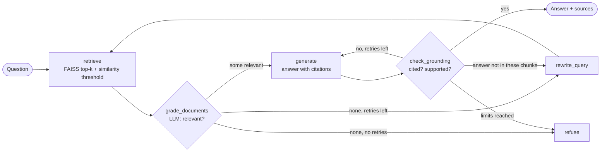

# ResearchRAG: Agentic AI Research Assistant

Ask questions across a set of research papers and get answers that are **grounded in the papers, cited to the page, and refused when the papers don't support an answer**.

Unlike a fixed retrieve-then-generate chain, ResearchRAG is a small **agent built with LangGraph**. It decides what to do next based on what it finds:

- **Grades** every retrieved chunk for relevance before using it
- **Rewrites the query** and searches again when nothing relevant comes back, or when the relevant chunks still don't contain the answer
- **Checks grounding**: every answer must cite passages, and a second LLM pass verifies the claims are supported
- **Regenerates or refuses** instead of returning an unsupported answer
- Shows its full **decision trace**, so you can see why it answered or refused

## Architecture



| Step | What happens |
|---|---|
| Ingest | PDFs loaded page by page, split with a recursive splitter (default 1000 chars, 150 overlap). Each chunk keeps its file, page and a chunk ID. |
| Index | `BAAI/bge-small-en-v1.5` embeddings via FastEmbed (ONNX, runs locally on CPU, no PyTorch), normalised and stored in FAISS with inner product, so scores are cosine similarity. The index rebuilds automatically when PDFs or chunk settings change. |
| Retrieve | Top-k chunks; anything below the similarity threshold is dropped before the agent sees it. |
| Grade | The LLM judges each chunk relevant or not. |
| Rewrite | If nothing relevant survives, the LLM rewrites the question into a better search query (max 2 rewrites). |
| Generate | Answer only from numbered passages, every sentence cited like `[1]`, or `NOT_FOUND`. If the relevant chunks don't contain the answer, the agent rewrites the query and searches again. |
| Ground | Answers with no valid citation are rejected without an LLM call; otherwise the LLM checks claims against the cited passages. One regeneration is allowed. |
| Refuse | If limits are reached, the agent says it can't answer instead of guessing. |

## Design decisions

- **Why an agent here, and not everywhere?** The steps depend on what retrieval returns: sometimes the first search is enough, sometimes the query needs rewriting, sometimes the honest answer is "not in these papers". A fixed chain can't make those choices. The loop is still bounded (max rewrites, max generations), so cost and behaviour stay predictable.
- **Refusing is a feature.** For research (or compliance), a confident wrong answer is worse than "I don't know".
- **Citations are checked, not trusted.** The model must cite passage numbers; out-of-range or missing citations fail the grounding step.
- **Testable without an API key.** The agent takes any LLM and any retrieval function, so the tests drive every decision path with a scripted fake model.

## Quick start

```bash
git clone https://github.com/Wik-Hrit/ResearchRAG-.git
cd ResearchRAG-
pip install -r requirements.txt
```

Create a `.env` file:
```
GROQ_API_KEY=your_groq_api_key_here
# optional: GROQ_MODEL=openai/gpt-oss-20b   (see console.groq.com/docs/models)
```

Add PDFs to `papers/`, then:

```bash
streamlit run streamlit_app.py      # web app: upload PDFs, chat, sources, agent trace
python app.py                       # command-line version
python app.py "What are the limitations of BPTT?"
```

Example CLI output:
```
--- Answer ---
BPTT has to propagate gradients through every time step, so on long sequences
they vanish or explode [1]. Reservoir computing avoids this by training only the readout [2].

--- Sources ---
  [1] reservoir_computing.pdf | page 4
  [2] reservoir_computing.pdf | page 2

--- Agent trace ---
  -> Retrieved 4 chunks for 'What are the limitations of BPTT?', dropped 1 below similarity 0.25
  -> Graded chunks: 2/3 relevant
  -> Generated answer (attempt 1) citing passages [1, 2]
  -> Grounding check passed
  -> Returned grounded answer
```

## Evaluating chunk size

`evaluate.py` measures retrieval quality across chunk sizes using a small labelled question set (question, expected PDF, expected page):

```bash
cp eval/questions.example.json eval/questions.json   # then write questions for your own papers
python evaluate.py --sizes 500 1000 1500 --k 4
```

It reports **hit@k** (was a correct chunk retrieved?) and **MRR** (how high was it ranked?) as a markdown table.

<!-- Paste your results here after running evaluate.py -->

## Deploy (Streamlit Community Cloud, free)

1. Push this repo to GitHub.
2. Go to [share.streamlit.io](https://share.streamlit.io), sign in with GitHub, click **Create app**.
3. Pick this repo, branch `main`, main file `streamlit_app.py`. Under **Advanced settings**, choose Python 3.12.
4. In **Secrets**, add:
   ```toml
   GROQ_API_KEY = "your_key"
   GROQ_MODEL = "openai/gpt-oss-20b"
   PUBLIC_MODE = "1"
   MAX_QUESTIONS_PER_SESSION = "15"
   # APP_PASSWORD = "optional-password"
   ```
5. Deploy.

`PUBLIC_MODE` gives every visitor a private temporary folder (nobody sees anyone else's PDFs), caps uploads at 3 files of 10 MB, and limits questions per session to protect the API quota. `APP_PASSWORD` adds a simple password gate.

## Tests

```bash
pytest -q
```

22 tests cover every agent path (answer, threshold filtering, query rewrite, refusal after max rewrites, regeneration after failed grounding, uncited answers, `NOT_FOUND`), index rebuild logic, the evaluation metrics, an end-to-end Streamlit run, the password gate and public-mode isolation, all without network access or an API key.

## Project structure

```
ResearchRAG/
├── streamlit_app.py        # web UI
├── app.py                  # CLI
├── evaluate.py             # chunk-size retrieval evaluation
├── researchrag/
│   ├── config.py           # settings (env-overridable)
│   ├── ingest.py           # PDF loading, chunking, FAISS index with auto-rebuild
│   └── agent.py            # LangGraph agent: grade, rewrite, generate, ground, refuse
├── tests/                  # pytest suite with fake LLM and embeddings
├── eval/questions.example.json
└── papers/                 # your PDFs (git-ignored)
```

## Next steps

- Hybrid search (BM25 + dense) for exact terms and acronyms
- Cross-encoder re-ranking of the top results
- Section-aware chunking for structured documents
- Swap Groq for a self-hosted small model (vLLM / Ollama) for fully local use
